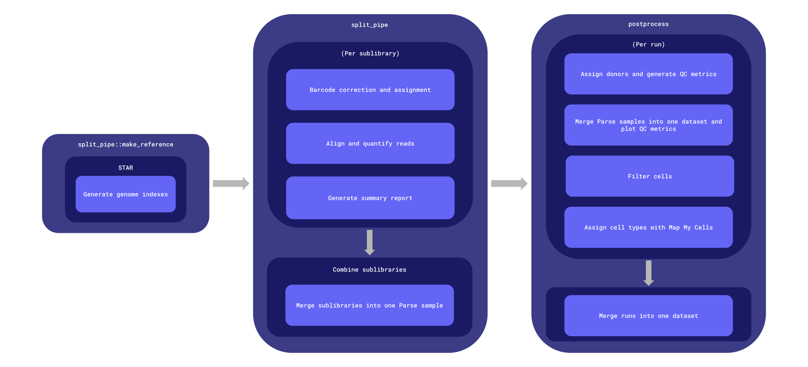

# split-pipe-wf

Repo for a workflow to process Parse Biosciences Evercode WT sc/sn RNA-seq data using Parse Biosciences' `split-pipe` pipeline, from FASTQs to a filtered, cell-typed AnnData object.

Common workflows, tasks, utility scripts, and docker images reused across harmonized ASAP workflows are defined in [the wf-common repository](https://github.com/ASAP-CRN/wf-common).

## Datasets processed

The workflow is written for any Parse Evercode WT dataset, but it has so far been run on a single dataset. Handling that is specific to that dataset is collected in [Dataset-specific handling](#dataset-specific-handling).

| Dataset | ASAP dataset ID | Parse runs | Workflow version | CRN release | Final object |
| :- | :- | :- | :- | :- | :- |
| `team-voet-pmdbs-sn-rnaseq-parsebio` | `DS_PMDBS_0038` | PB-001, PB-002 | v1.0.0 | v6.0.0 | `gs://asap-curated-team-voet-pmdbs-sn-rnaseq-parsebio/pmdbs_split_pipe/release/v6.0.0/postprocess/DS_PMDBS_0038.merged.mmc.h5ad` |

The object above is the filtered, raw-count result of merging the dataset's two Parse runs; it is not integrated or batch-corrected. The runs are separate batches with different designs:
- `PB-001` is from the Evercode WT v1 kit and contains only cingulate gyrus (CG) samples from healthy donors.
- `PB-002` is from the Evercode WT Mega v1 kit and contains a mixture of CG and substantia nigra (SN) samples from both healthy controls and Parkinson's disease (PD) patients. 

All PD and SN samples are in `PB-002` and so correcting for batch could potentially remove biological signal.


# Table of contents

- [Workflows](#workflows)
    - [split-pipe processing](#split-pipe-processing)
    - [Postprocessing](#postprocessing)
- [Inputs](#inputs)
    - [Postprocess inputs](#postprocess-inputs)
    - [Structs](#structs)
    - [Generating the inputs JSON](#generating-the-inputs-json)
- [Outputs](#outputs)
    - [Output structure](#output-structure)
    - [Workflow outputs](#workflow-outputs)
    - [AnnData contents](#anndata-contents)
- [Dataset-specific handling](#dataset-specific-handling)
    - [Pooled Parse samples (vireo)](#pooled-parse-samples-vireo)
    - [DS_PMDBS_0038](#ds_pmdbs_0038-team-voet-pmdbs-sn-rnaseq-parsebio)
- [Docker images](#docker-images)


# Workflows

Workflows are defined in [the `workflows` directory](workflows).

Workflow names:
- `split_pipe_analysis` ([workflows/main.wdl](workflows/main.wdl)): the full workflow. Builds
  the reference once, then for each Parse run calls `split_pipe` and `postprocess`, merges the
  runs (`merge_runs`) and copies the final outputs to the staging buckets.
- `split_pipe` ([workflows/split_pipe/split_pipe.wdl](workflows/split_pipe/split_pipe.wdl)):
  `split-pipe` processing for one Parse run, from FASTQs to the combined (`comb`) output.
- `postprocess` ([workflows/postprocess/postprocess.wdl](workflows/postprocess/postprocess.wdl)):
  from one run's `comb` output to a filtered, cell-typed AnnData object.

`split_pipe` and `postprocess` can also be run on their own.



**Entrypoint**: [workflows/main.wdl](workflows/main.wdl)

**Input template**: [workflows/inputs_template.json](workflows/inputs_template.json)

The Python scripts used by postprocessing are in [docker/parsebio_tools/scripts](docker/parsebio_tools/scripts). Merging, QC plotting and filtering reuse the `sc_tools` scripts from [sc-rnaseq-wf](https://github.com/ASAP-CRN/sc-rnaseq-wf), so QC metric definitions and filter thresholds match the 10X workflow.

## split-pipe processing

A Parse experiment is sequenced as several **sublibraries**, each an aliquot of
one mixed pool of barcoded nuclei. Each is processed independently and the
results are combined afterwards:

```
make_reference           once per reference; builds the STAR index (mkref)
        │
        ├── split_pipe   scattered, one call per sublibrary (mode: all)
        │
combine_sublibraries     gather; resolves cells to samples across sublibraries (mode: comb)
```

`make_reference` is skipped when a prebuilt index is supplied via
`genome_ref_tar_gz`. The index used is returned as `genome_ref_tar_gz_used`, so it can be
passed back in later submissions.

`combine_sublibraries` requires at least two sublibraries, and any subset of a kit run may be
combined: each sublibrary contains a proportion of cells from all samples.

## Postprocessing

Run once per Parse run (one kit's worth of samples, e.g. `PB-001`), on that run's `comb` output.

```
prep_parse_sample          scattered, one call per Parse sample (e.g. pool_1)
  ├── assign_donors.py         cells → subject, from a donor demultiplexing table (vireo)
  │                            or a single known subject (un-pooled sample)
  └── prep_parse_sample.py     AnnData from DGE_filtered; QC metrics, scrublet scores,
                               ASAP SAMPLE/SUBJECT metadata
        │
merge_and_plot_qc_metrics  gather; concatenates Parse samples, pre-filter QC violin plots
        │                  (sc_tools merge_and_plot_qc)
filter
  ├── drop_unassigned_cells.py drops cells without an ASAP sample (vireo doublet/unassigned)
  └── filter                   sc_tools filter: mito, doublet score, count/gene limits and
                               per-sample MAD outliers
        │
map_cell_types             MapMyCells (cell_type_mapper), on-the-fly markers from gene symbols
        │                  (sc_tools mmc)
add_mapped_cell_types      attaches MMC labels and phenotypes (sc_tools transcriptional_phenotype)
```

After every run is postprocessed, `merge_runs` (in `main.wdl`) concatenates the per-run
cell-typed objects into one object (`merge_runs.py`). It checks that runs share the gene set,
carry distinct `batch` values and have unique cell IDs. Runs can be merged at the end because
no sample spans two runs and MMC labels each cell independently.

Notes:

- **Parse sample ≠ ASAP sample.** A Parse sample is what was loaded into round-1 wells. In
  pooled designs it holds several donors, which are resolved per cell by `assign_donors.py`
  (see [Pooled Parse samples](#pooled-parse-samples-vireo)). The ASAP sample ID is then looked
  up from (batch, subject); `split-pipe`'s own `sample` column is kept as `parse_sample`.
- **Cells come from `DGE_filtered`**, i.e. `split-pipe`'s own cell calling, for every Parse
  sample, pooled or not.
- **Doublets.** Scrublet runs on every called cell, including vireo doublets, so its
  `doublet_score` sees the full doublet population. Vireo detects doublets between donors,
  and scrublet detects doublets between cell types; both are applied.
- **Cell IDs** are `<bc_wells>_<run_id>.<parse_sample>_<n>` (e.g. `01_01_15__s1_PB-001.pool_1_0`),
  unique across Parse runs. The trailing `_<n>` is the merge chunk added by sc_tools
  `merge_and_plot_qc`, as in sc-rnaseq-wf.


# Inputs

An input template file can be found at
[workflows/inputs_template.json](workflows/inputs_template.json).

The reference is built from the Cell Ranger GRCh38-2024-A FASTA and GTF
(`fasta/genome.fa`, `genes/genes.gtf.gz`), the same annotation sc-rnaseq-wf uses, so both
workflows count the same gene set.

Inputs that differ between Parse runs (kit, chemistry, batch, sublibraries, Parse samples)
are fields of each [ParseRun](#parserun); everything else is shared.

| Type | Name | Description |
| :- | :- | :- |
| String | asap_dataset_id | ASAP dataset ID (e.g. `DS_PMDBS_0038`); used in output names and the `obs` `dataset` and `batch_id` columns. |
| String | team_id | ASAP team identifier; used in `batch_id`. |
| Array[[ParseRun](#parserun)] | parse_runs | The Parse runs (kits) in the dataset. |
| String | genome_name | Genome name; used to name the reference. Options: 'hg38' (human) or 'mm10' (mouse). |
| File? | genome_ref_tar_gz | Prebuilt `split-pipe` mkref index, as a gzipped tarball. If supplied, `make_reference` is skipped; if omitted, an index is built once from `genome_fasta` and `genes_gtf` and shared by all runs. |
| File | genome_fasta | Reference genome FASTA. Only used when `genome_ref_tar_gz` is omitted. |
| File | genes_gtf | Reference gene annotation GTF. Only used when `genome_ref_tar_gz` is omitted. |
| File? | parameter_file | `split-pipe --parfile`; one `key value` pair per line, passed to every sublibrary and `comb` call. Use [split_pipe_params.txt](workflows/split_pipe/split_pipe_params.txt) (`log_memory_use False`): `split-pipe`'s memory profiler can otherwise fail a run with `psutil.NoSuchProcess`. |
| File | sample_csv | ASAP `SAMPLE.csv`. |
| File | subject_csv | ASAP `SUBJECT.csv`. |
| Int | pct_counts_mt_max | Maximum percentage of mitochondrial gene counts allowed per cell. [10] |
| Float | doublet_score_max | Maximum scrublet doublet score allowed per cell. [0.2] |
| Array[Int] | total_counts_limits | Absolute minimum and maximum total UMI counts per cell. [500, 150000] |
| Array[Int] | n_genes_by_counts_limits | Absolute minimum and maximum number of genes detected per cell. [300, 15000] |
| Float | n_mads_lower | Number of MADs below the per-sample median allowed for total counts and genes detected. [3] |
| Float | n_mads_upper | Number of MADs above the per-sample median allowed for total counts and genes detected. [5] |
| String | mmc_taxonomy | Taxonomy of the MapMyCells reference; appended to MMC output names (e.g. `siletti_20240330`). |
| File | allen_brain_mmc_precomputed_stats_h5 | MapMyCells precomputed statistics for the reference taxonomy. |
| File? | allen_brain_mmc_marker_genes_json | Marker gene lookup; if supplied, skips on-the-fly marker computation. |
| String | raw_data_bucket | Dataset raw data bucket (e.g. `gs://asap-raw-team-xxyy-pmdbs-sn-rnaseq-parsebio`); outputs are uploaded under `workflow_execution/pmdbs_split_pipe/`. See [Output structure](#output-structure). |
| Array[String] | staging_data_buckets | Staging buckets (dev, and uat unless embargoed) that final outputs are copied to. |
| String | container_registry | Container registry where workflow Docker images are hosted. |
| String? | zones | GCP zones where compute will take place. ['us-central1-c us-central1-f'] |

## Postprocess inputs

| Type | Name | Description |
| :- | :- | :- |
| File | combined_sublibs_tar_gz | The `split-pipe --mode comb` output directory for one Parse run, as a gzipped tarball. |
| String | asap_dataset_id | ASAP dataset ID (e.g. `DS_PMDBS_0038`); used in output names and the `obs` `dataset` and `batch_id` columns. |
| String | team_id | ASAP team identifier; used in `batch_id`. |
| String | run_id | Parse run ID (e.g. `PB-001`); used in output names and cell IDs. |
| String | batch | `SAMPLE.csv` batch value for this Parse run (e.g. `Batch1`). |
| Array[[ParseSample](#parsesample)] | parse_samples | The Parse samples to process, and how to assign their cells to donors. |
| File | sample_csv | ASAP `SAMPLE.csv`. |
| File | subject_csv | ASAP `SUBJECT.csv`. |
| File? | sample_map | CSV of `parse_sample,subject_id,sample_id`. Required when a subject has more than one sample in the batch, e.g. two brain regions loaded in different Parse samples. See [Sample map](#sample-map). |
| Int | pct_counts_mt_max | Maximum percentage of mitochondrial gene counts allowed per cell. [10] |
| Float | doublet_score_max | Maximum scrublet doublet score allowed per cell. [0.2] |
| Array[Int] | total_counts_limits | Absolute minimum and maximum total UMI counts per cell, applied on top of the MAD-based thresholds. [500, 150000] |
| Array[Int] | n_genes_by_counts_limits | Absolute minimum and maximum number of genes detected per cell, applied on top of the MAD-based thresholds. [300, 15000] |
| Float | n_mads_lower | Number of MADs below the per-sample median allowed for total counts and genes detected. [3] |
| Float | n_mads_upper | Number of MADs above the per-sample median allowed for total counts and genes detected. [5] |
| String | mmc_taxonomy | Taxonomy of the MapMyCells reference; appended to MMC output names. |
| File | allen_brain_mmc_precomputed_stats_h5 | MapMyCells precomputed statistics for the reference taxonomy. |
| File? | allen_brain_mmc_marker_genes_json | Marker gene lookup; if supplied, skips on-the-fly marker computation. |
| String | container_registry | Container registry where workflow Docker images are hosted. |
| String | zones | Space-delimited GCP zones where compute will take place (no default when run on its own). |

Filter and MMC defaults match sc-rnaseq-wf.

When `split_pipe` or `postprocess` is run on its own, it also needs the values `main.wdl`
otherwise supplies: `workflow_name`, `workflow_version`, `workflow_release`, `run_timestamp`,
`raw_data_path_prefix`, `billing_project` and `zones` (which has a default only in `main.wdl`).

## Structs

### ParseRun

One Parse run: one kit's worth of samples, processed by `split_pipe` and `postprocess`.

| Type | Name | Description |
| :- | :- | :- |
| String | run_id | Parse run ID (e.g. `PB-001`); used in output names and cell IDs. |
| String | kit | Parse Biosciences kit. Options: 'WT_mini', 'WT', 'WT_mega', 'WT_mega_384', 'WT_penta', 'WT_penta_384'. |
| String | chemistry | Parse Biosciences chemistry version. Options: 'v1'–'v4'. |
| String | batch | `SAMPLE.csv` batch value for this run (e.g. `Batch1`). |
| File | sample_list_tsv | Sample table; one `sample_name<whitespace>wells` line per Parse sample, where wells are **round-1** wells: how samples were aliquoted onto the plate prior to the rounds of barcoding (e.g. `sample_1 A1-A12,B1-B3`). Every sublibrary of the run takes the same file. |
| File? | sample_map | See [Sample map](#sample-map). |
| Array[[Sublibrary](#sublibrary)] | sublibraries | The run's sublibraries and their reads. When vireo tables are used, list sublibraries in the order vireo was computed on (see [Pooled Parse samples](#pooled-parse-samples-vireo)). |
| Array[[ParseSample](#parsesample)] | parse_samples | The run's Parse samples, and how to assign their cells to donors. |

### Sublibrary

| Type | Name | Description |
| :- | :- | :- |
| String | sublibrary_id | Identifier for the sublibrary (e.g. `PB-001a`); used in output names. |
| Array[File]+ | fastq_R1s | Read 1 (cDNA) FASTQs. Multiple files are accepted where a sublibrary was sequenced across lanes or runs. |
| Array[File]+ | fastq_R2s | Read 2 (barcode) FASTQs, in the same order as `fastq_R1s`. |

### ParseSample

Exactly one of `vireo_donor_ids` and `subject_id` must be set.

| Type | Name | Description |
| :- | :- | :- |
| String | parse_sample_name | Parse sample name, as in the sample table; must match a `comb` output subdirectory. |
| File? | vireo_donor_ids | Vireo donor assignment TSV for a pooled Parse sample (columns `cell`, `donor_id`, ...); `cell` must match `split-pipe`'s `bc_wells`, including the `__s<n>` sublibrary suffix. |
| String? | subject_id | Subject ID for an un-pooled Parse sample; assigned to every cell. |

Requirements for vireo tables are in [Pooled Parse samples](#pooled-parse-samples-vireo).

## Generating the inputs JSON

The inputs JSON may be written by hand, but tracking sublibraries, FASTQs and Parse samples
across runs is error-prone. The
[`generate_split_pipe_inputs.py` utility script](util/workflow_inputs/generate_split_pipe_inputs.py)
builds it from the ASAP metadata tables plus two small TSVs describing the Parse runs, and
writes `inputs.{staging_env}.{dataset_id}.{date}.json`. It is currently tailored to
`DS_PMDBS_0038` (see [Dataset-specific handling](#dataset-specific-handling)).

How the tables relate, for a run such as PB-001 (4 Parse samples covering 16 donors, split
into 8 sublibraries):

- **Run** (`PB-001`): one Parse kit. All Parse samples are pooled after barcoding and split
  into sublibraries for sequencing.
- **Sublibrary** (`PB-001a`): identified by `DATA.csv`/`SAMPLE.csv` `pool_id` (`PB001a`); its
  FASTQs contain a proportion of cells from every donor in the run.
- **Parse sample** (`pool_1`): what was aliquoted into round-1 wells before barcoding. A pooled
  Parse sample holds several donors and needs a vireo table; an un-pooled one is a single
  subject.

Inputs:

- `data-csv`: ASAP `DATA.csv`. Gives the ASAP dataset ID (`ASAP_dataset_id`, written as
  `asap_dataset_id`), each sublibrary's FASTQ gs URIs and its batch. `pool_id` must have the form
  `<prefix><run number><sublibrary letter(s)>`, e.g. `PB001a` → run `PB-001`, sublibrary
  `PB-001a`. FASTQs are deduplicated and R1/R2 are paired by file name.
- `sample-csv`: ASAP `SAMPLE.csv`. Its `protocol_id` (one per batch) gives the `split-pipe`
  kit and chemistry, e.g. `Evercode_WT_v1` → `WT`/`v1`. Protocols not yet listed in
  `PROTOCOL_KIT_CHEMISTRY` fail with a message.
- `runs-tsv`: one row per Parse run, with columns:
    - `run_id`: Parse run ID (e.g. `PB-001`); must match the runs in `DATA.csv`.
    - `sample_list_tsv`: gs URI of the run's `split-pipe` sample list.
    - `sample_map`: gs URI of the run's [sample map](#sample-map); leave empty if not needed.
- `parse-samples-tsv`: one row per Parse sample, with columns:
    - `run_id`: Parse run ID.
    - `parse_sample_name`: Parse sample name, as in the sample list.
    - `vireo_donor_ids`: gs URI of the vireo table, for a pooled Parse sample.
    - `subject_id`: the subject, for an un-pooled Parse sample. Set exactly one of
      `vireo_donor_ids` and `subject_id`.
- `inputs-template`: inputs JSON with the run-independent values filled in (reference, MMC,
  filter parameters, `parameter_file`, `container_registry`). Dataset, run and bucket keys are
  overwritten; the script warns about values still left as type descriptions.
- `dataset-id`: dataset name used in bucket names (`gs://asap-raw-{dataset_id}`,
  `gs://asap-{dev,uat}-{dataset_id}`), e.g. `team-voet-pmdbs-sn-rnaseq-parsebio`. Not the ASAP
  dataset ID, which is read from `DATA.csv`.
- `team-id`: ASAP team identifier; used in `batch_id`.
- `embargoed`: stage to the dev bucket only; otherwise dev and uat. [false]

Sublibraries are written in alphabetical order of `sublibrary_id`.

```bash
python3 util/workflow_inputs/generate_split_pipe_inputs.py \
    --data-csv DATA.csv \
    --sample-csv SAMPLE.csv \
    --runs-tsv split_pipe_runs.tsv \
    --parse-samples-tsv split_pipe_parse_samples.tsv \
    --inputs-template inputs_template.filled.json \
    --dataset-id team-xxyy-pmdbs-sn-rnaseq-parsebio \
    --team-id team-xxyy
```


# Outputs

## Output structure

- `workflow_run_timestamp`: format: `%Y-%m-%dT%H-%M-%SZ`
- `asap_dataset_id` in file names is the ASAP dataset ID (e.g. `DS_PMDBS_0038`); bucket names use
  the dataset name (e.g. `team-voet-pmdbs-sn-rnaseq-parsebio`).
- Every uploaded file has a `<file>.meta.tsv` sidecar recording its timestamp, workflow name,
  workflow version and GitHub release.
- The `MANIFEST.tsv` file in each staging directory describes the file name, md5 hash,
  timestamp, workflow version, workflow name, and workflow release for the run used to
  generate each file in that directory.

### Raw data (intermediate files and final outputs for all runs of the workflow)

In the workflow, task outputs are either specified as `String` (final outputs, uploaded by the
task to the raw data bucket and then copied to the staging buckets) or `File` (intermediate
outputs, which live in the cromwell-output bucket and are periodically cleaned up). Each
submission writes to its own `${workflow_run_timestamp}` directory, so earlier runs are not
overwritten.

```bash
asap-raw-team-xxyy-pmdbs-sn-rnaseq-parsebio
└── workflow_execution
    └── pmdbs_split_pipe
        ├── split_pipe
        │   └── ${split_pipe_workflow_version}
        │       └── ${workflow_run_timestamp}
        │           └── <split_pipe outputs>
        └── postprocess
            └── ${postprocess_workflow_version}
                └── ${workflow_run_timestamp}
                    └── <postprocess outputs, and the merged object>
```

### Staging data (final workflow outputs for the latest run of the workflow)

The objects in the dev or uat bucket are synced into the curated data buckets, maintaining the same
file structure, using [the `promote_staging_data` script](https://github.com/ASAP-CRN/wf-common/blob/main/util/data_promotion/promote_staging_data).

```bash
asap-{dev,uat}-team-xxyy-pmdbs-sn-rnaseq-parsebio
└── pmdbs_split_pipe
    └── release
        └── ${crn_release_version}
            ├── split_pipe
            │   ├── ${asap_dataset_id}.${sublibrary_id}.name_sorted.bam
            │   ├── ${asap_dataset_id}.${sublibrary_id}.barcode_headLog.final.out
            │   ├── ${asap_dataset_id}.${run_id}.combined_sublibs.tar.gz
            │   ├── ${asap_dataset_id}.${run_id}.combined_sublibs.all-sample_analysis_summary.html
            │   ├── ${asap_dataset_id}.${run_id}.combined_sublibs.agg_sample_summary.csv
            │   └── MANIFEST.tsv
            └── postprocess
                ├── ${asap_dataset_id}.${run_id}.merged_unfiltered.h5ad
                ├── ${asap_dataset_id}.${run_id}.initial_metadata.csv
                ├── ${asap_dataset_id}.${run_id}.doublet_score.violin.png
                ├── ${asap_dataset_id}.${run_id}.n_genes_by_counts.violin.png
                ├── ${asap_dataset_id}.${run_id}.pct_counts_mt.violin.png
                ├── ${asap_dataset_id}.${run_id}.pct_counts_rb.violin.png
                ├── ${asap_dataset_id}.${run_id}.total_counts.violin.png
                ├── ${asap_dataset_id}.${run_id}.unassigned_removed_cells.csv
                ├── ${asap_dataset_id}.${run_id}.filtered_out_cells.csv
                ├── ${asap_dataset_id}.${run_id}.{mmc_otf_mapping,mmc_markers_mapping}.${mmc_taxonomy}.extended_results.json
                ├── ${asap_dataset_id}.${run_id}.{mmc_otf_mapping,mmc_markers_mapping}.${mmc_taxonomy}.results.csv
                ├── ${asap_dataset_id}.${run_id}.{mmc_otf_mapping,mmc_markers_mapping}.${mmc_taxonomy}.log.txt
                ├── ${asap_dataset_id}.${run_id}.mmc_results.parquet
                ├── ${asap_dataset_id}.merged.mmc.h5ad
                └── MANIFEST.tsv
```

`mmc_otf_mapping` is used when markers are computed on the fly, and `mmc_markers_mapping`
when `allen_brain_mmc_marker_genes_json` is supplied.

## Workflow outputs

Outputs of `split_pipe_analysis`, grouped by the sub-workflow that produces them. Per-run
outputs are arrays with one entry per Parse run; per-sublibrary and per-Parse-sample outputs are
nested arrays. When `split_pipe` or `postprocess` is run on its own, it returns only its own
group, for its single run (one array level fewer). Outputs not marked as staged are
intermediates in the cromwell-output bucket.

### From `split_pipe`

| Type | Name | Staged | Description |
| :- | :- | :- | :- |
| Array[Array[File]] | sublibrary_tar_gz | | Per sublibrary: the `split-pipe --mode all` output directory, as a gzipped tarball; input to `comb`. |
| Array[Array[File]] | sublibrary_bams | ✓ | Per sublibrary: `${asap_dataset_id}.${sublibrary_id}.name_sorted.bam`, the `split-pipe` aligned, name-sorted BAM. |
| Array[Array[File]] | sublibrary_star_logs | ✓ | Per sublibrary: `${asap_dataset_id}.${sublibrary_id}.barcode_headLog.final.out`, the STAR alignment summary. |
| Array[File] | combined_sublibs_tar_gz | ✓ | `${asap_dataset_id}.${run_id}.combined_sublibs.tar.gz`; the `comb` output directory, including the per-sample count matrices (`DGE_filtered`, `DGE_unfiltered`) and reports. |
| Array[File] | all_sample_summary_html | ✓ | The `comb` all-sample HTML summary report. |
| Array[File] | agg_sample_summary_csv | ✓ | The `comb` per-sample summary statistics. |

### From `postprocess`

| Type | Name | Staged | Description |
| :- | :- | :- | :- |
| Array[Array[File]] | prepped_adata | | Per Parse sample: `${asap_dataset_id}.${run_id}.${parse_sample}.prepped.h5ad`, all called cells with donor assignments, QC metrics, scrublet scores and ASAP metadata. |
| Array[File] | merged_adata | ✓ | `${asap_dataset_id}.${run_id}.merged_unfiltered.h5ad`; all Parse samples concatenated, before any filtering. |
| Array[File] | initial_metadata | ✓ | `${asap_dataset_id}.${run_id}.initial_metadata.csv`; `obs` of the merged object. |
| Array[Array[File]] | qc_plots | ✓ | Pre-filter violin plots of `n_genes_by_counts`, `total_counts`, `pct_counts_mt`, `pct_counts_rb` and `doublet_score`. |
| Array[File] | filtered_adata_object | | `${asap_dataset_id}.${run_id}.filtered.h5ad`; cells passing donor assignment and all QC filters. |
| Array[File] | unassigned_removed_cells_csv | ✓ | Cells removed for having no ASAP sample (vireo `doublet`/`unassigned`). |
| Array[File] | filtered_out_cells_csv | ✓ | Cells removed by `filter`, with a column per filter they failed. Same layout as `unassigned_removed_cells_csv`. |
| Array[File] | mmc_results_csv, mmc_extended_results_json, mmc_log_txt | ✓ | MapMyCells outputs: per-cell assignments, full results (incl. the marker genes used) and log. |
| Array[File] | mmc_adata_object | | `${asap_dataset_id}.${run_id}.mmc.h5ad`; the filtered object with cell type labels; input to `merge_runs`. |
| Array[File] | mmc_results_parquet | ✓ | Per-cell cell type labels. |

Run on its own, `postprocess` also returns `postprocess_raw_data_path`, the raw data bucket
directory its outputs were uploaded to; `split_pipe_analysis` uses it to upload the merged object
alongside them.

### From `split_pipe_analysis` only

| Type | Name | Staged | Description |
| :- | :- | :- | :- |
| File | genome_ref_tar_gz_used | | The `split-pipe` mkref index used; pass as `genome_ref_tar_gz` to skip `make_reference` in later submissions. |
| File | final_merged_adata | ✓ | `${asap_dataset_id}.merged.mmc.h5ad`; all runs' filtered, cell-typed cells, raw counts, all genes (see [AnnData contents](#anndata-contents)). |
| Array[File] | split_pipe_manifest_tsvs, postprocess_manifest_tsvs | | The `MANIFEST.tsv` written to each staging bucket. |

## AnnData contents

Raw counts are in `X`. All genes are kept; no gene filtering is applied.

| Location | Contents |
| :- | :- |
| `var` index | Gene symbol, made unique with a `-<n>` suffix as in sc-rnaseq-wf |
| `var["gene_id"]` | Ensembl ID |
| `obs["sample"]` | ASAP sample ID (`ASAP_sample_id`); `NA` for vireo doublet/unassigned cells |
| `obs["parse_sample"]` | Parse sample the cell was loaded in (e.g. `pool_1`) |
| `obs["subject_id"]` | Assigned subject, or `doublet`/`unassigned` |
| `obs["vireo_*"]` | Vireo statistics (`prob_max`, `prob_doublet`, `n_vars` = informative SNPs, ...); `NA` for un-pooled samples |
| `obs["n_genes_by_counts"]`, `obs["total_counts"]`, `obs["pct_counts_mt"]`, `obs["pct_counts_rb"]` | QC metrics, as in sc-rnaseq-wf |
| `obs["doublet_score"]` | Scrublet doublet score, per Parse sample |
| `obs["mread_count"]` | Sequencing reads per cell (`split-pipe`) |
| `obs["bc1_well"]`, `obs["bc2_well"]`, `obs["bc3_well"]` | Plate wells for each barcoding round |
| `obs["sex"]`, `obs["brain_region_level_1"]`–`obs["brain_region_level_3"]` | From ASAP metadata, lower-cased |
| `obs["batch"]`, `obs["team"]`, `obs["dataset"]`, `obs["batch_id"]` | Run-level metadata; `dataset` is the ASAP dataset ID and `batch_id` = `${team}_${dataset}_${batch}` (e.g. `team-voet_DS_PMDBS_0038_Batch1`), as in sc-rnaseq-wf |
| `obs["supercluster_name"]`, `obs["cluster_name"]`, `obs["subcluster_name"]`, `obs["rho"]`, `obs["prob"]` | MapMyCells assignment and confidence (cell-typed objects only) |
| `obs["cell_type"]`, `obs["phenotype"]` | Labels from sc_tools `transcriptional_phenotype`, as in sc-rnaseq-wf (cell-typed objects only) |


# Dataset-specific handling

The workflow's core path (`split-pipe`, QC, filtering, MapMyCells) is the same for every Parse
dataset. What varies is how cells are assigned to donors, which depends on the experimental
design, plus a few keyed exceptions for specific datasets. Check this section when processing a
new Parse dataset.

## Pooled Parse samples (vireo)

Applies when a Parse sample pools several donors and is demultiplexed by genotype with
[vireo](https://github.com/single-cell-genetics/vireo). An un-pooled Parse sample only needs
its `subject_id` and skips all of this.

- **Sublibrary order.** `comb` assigns the `__s<n>` suffix in `bc_wells` from the order of the
  supplied sublibraries. A vireo table only matches when sublibraries are listed in the same
  order as the run it was computed on.
- **Match checks.** `assign_donors.py` fails if fewer than 5% of called cells, or of any single
  sublibrary's called cells, match the vireo table, and warns below 50%. A random overlap
  (e.g. the wrong vireo file, or sublibraries in a different order) matches ~1–3%. A partial
  match is expected where `split-pipe` calls more cells than vireo was run on (e.g. PB-002 pool_1).
- **Unnamed donors.** Vireo names a donor it learned without a supplied genotype by position
  (`donor<N>`). These are renamed to a subject only where the contributors confirmed the
  identity (`VIREO_DONOR_RENAMES` in `assign_donors.py`, keyed by ASAP dataset ID and Parse
  sample); any other `donor<N>` fails `assign_donors.py`.

### Sample map

Vireo identifies the *subject*, but ASAP metadata is keyed by *sample*. If a subject
contributed more than one sample to the same Parse run (e.g. two brain regions, loaded in
different Parse samples), the sample is resolved from the Parse sample the cell was loaded in.
`SAMPLE.csv` can't provide this link: its `pool_id` is the sublibrary, and every sublibrary
contains cells from every sample.

`sample_map` is a CSV with columns `parse_sample,subject_id,sample_id` (`sample_id` as in
`SAMPLE.csv`). It needs a row for each sample of every subject with more than one sample in the
run; other subjects can be left out. Without it, `prep_parse_sample` fails and names the
subjects that need a row.

## DS_PMDBS_0038 (`team-voet-pmdbs-sn-rnaseq-parsebio`)

| Run | Batch | Kit / chemistry | Sublibraries | Parse samples |
| :- | :- | :- | :- | :- |
| PB-001 | Batch1 | WT / v1 | 8 (`PB-001a`–`PB-001h`) | 4 (`pool_1`, `63B`, `pool_2`, `pool_3`) |
| PB-002 | Batch2 | WT_mega / v1 | 16 (`PB-002a`–`PB-002p`) | 10 (`pool_1`–`pool_10`) |

- **Donor pooling.** Every Parse sample except `63B` pools several donors and is demultiplexed
  with a vireo table supplied by the contributors. `63B` is un-pooled (subject `ASA_063`).
- **Sublibrary order.** The vireo tables were computed with sublibraries in alphabetical order,
  which is the order `generate_split_pipe_inputs.py` writes.
- **Unnamed vireo donors.** `donor9` in PB-002 `pool_5` was confirmed by the contributors as
  `ASA_137` and is renamed in `VIREO_DONOR_RENAMES`.
- **Sample map.** In PB-002 some subjects contributed more than one sample, so PB-002 takes a
  [sample map](#sample-map).
- **Inputs generator.** `generate_split_pipe_inputs.py` assumes this dataset's `pool_id` format
  (`PB001a`) and knows only its two protocols (`Evercode_WT_v1`, `Evercode_WT_MEGA_v1`).
- **Handling batch.** For reference, the contributors analyzed each Parse run with region-matched
  10x Chromium data (scVI integration) rather than merging the two runs. Batch correction between
  the two runs was skipped here as the run batch is partly confounded with disease and region.


# Docker images

Docker images are defined in [the `docker` directory](docker). Each image must minimally define a `build.env` file and a `Dockerfile`.

Structure:
```bash
docker
├── parsebio_tools
│   ├── build.env
│   ├── Dockerfile
│   └── scripts
└── split_pipe
    ├── build.env
    └── Dockerfile
```

`parsebio_tools` extends the sc-rnaseq-wf `sc_tools` image with the postprocessing scripts. The base is pinned by digest in `build.env` (`SC_TOOLS_DIGEST`), so library versions match the 10X workflow exactly.

## Acquiring split-pipe software

`split-pipe` is a proprietary pipeline owned by Parse Biosciences and licensed to DNAStack. Community users therefore must acquire their own license directly from Parse Biosciences if they wish to replicate this workflow. For DNAstack internal use, `split-pipe` is stored in a private Google bucket and must be saved as `docker/split_pipe/split-pipe-v{version_number}.zip`.


## The `build.env` file

Each target image is defined using the `build.env` file, which is used to specify the name and version tag for the corresponding Docker image. It must contain at minimum the following variables:

- `IMAGE_NAME`
- `IMAGE_TAG`

All variables defined in the `build.env` file will be made available as build arguments during Docker image build.

The `DOCKERFILE` variable may be used to specify the path to a Dockerfile if that file is not found alongside the `build.env` file, for example when multiple images use the same base Dockerfile definition.

## Building Docker images

Docker images can be built using the [`build_docker_images`](https://github.com/DNAstack/bioinformatics-scripts/blob/main/scripts/build_docker_images) script.

```bash
# Build a single image
./build_docker_images -d docker/split_pipe

# Build all images in the `docker` directory
./build_docker_images -d docker

# Build and push all images in the docker directory, using the `dnastack` container registry
./build_docker_images -d docker -c dnastack -p
```


## Tool and library versions

| Image | Major tool versions | Links |
| :- | :- | :- |
| split_pipe | <ul><li>[split-pipe v1.8.2 (login required)](https://support.parsebiosciences.com/hc/en-us/articles/17200056667924-Pipeline-Download-Current-Version)</li><li>[google-cloud-cli 584.0.0](https://docs.cloud.google.com/sdk/docs/release-notes)</li><li>[python 3.12.8](https://www.python.org/downloads/release/python-3128/)</li><li>[miniconda 26.5.3](https://docs.anaconda.com/miniconda/miniconda-release-notes/)</li><li>`upload_outputs` from wf-common `util` 1.3.0</li></ul> | [Dockerfile](https://github.com/ASAP-CRN/split-pipe-wf/tree/main/docker/split_pipe) |
| parsebio_tools | <ul><li>Base: `sc_tools` 1.3.0, pinned by digest (scanpy, anndata and scrublet versions inherited)</li></ul> | [Dockerfile](https://github.com/ASAP-CRN/split-pipe-wf/tree/main/docker/parsebio_tools) |
